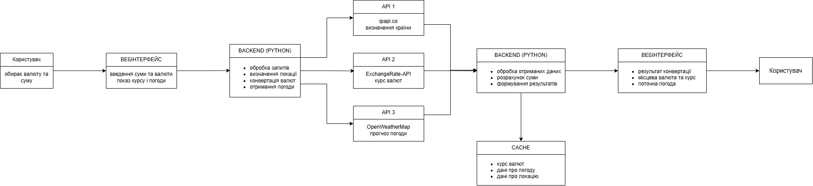
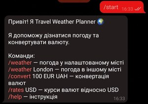
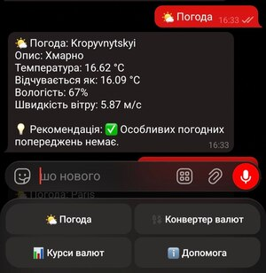
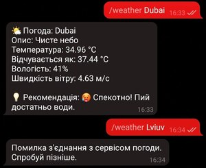
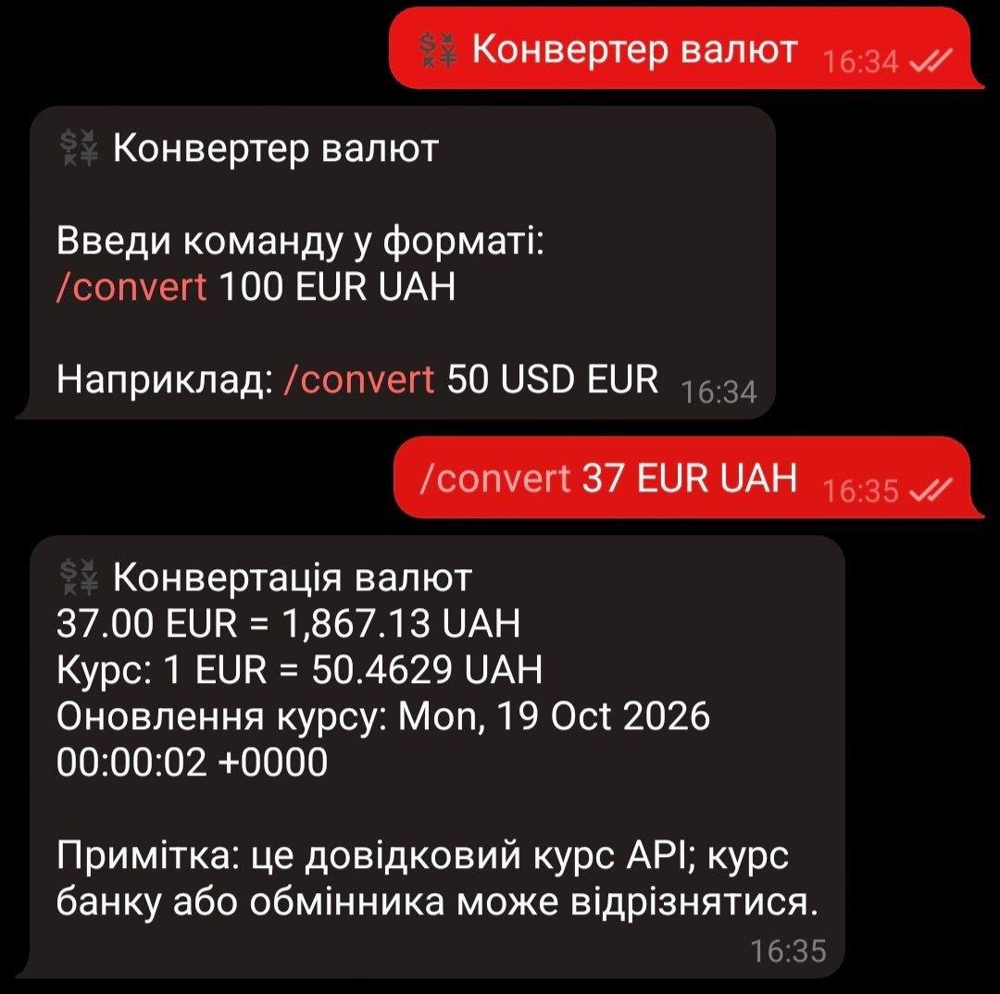
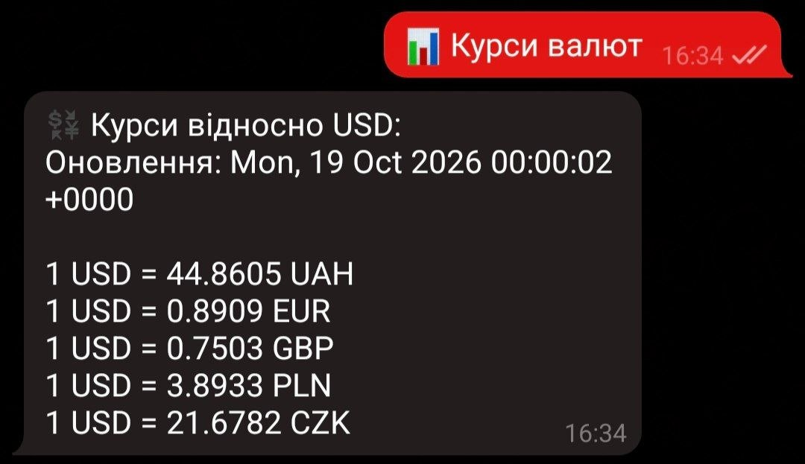
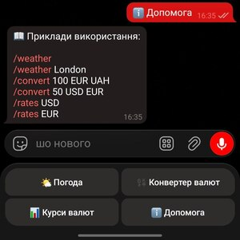
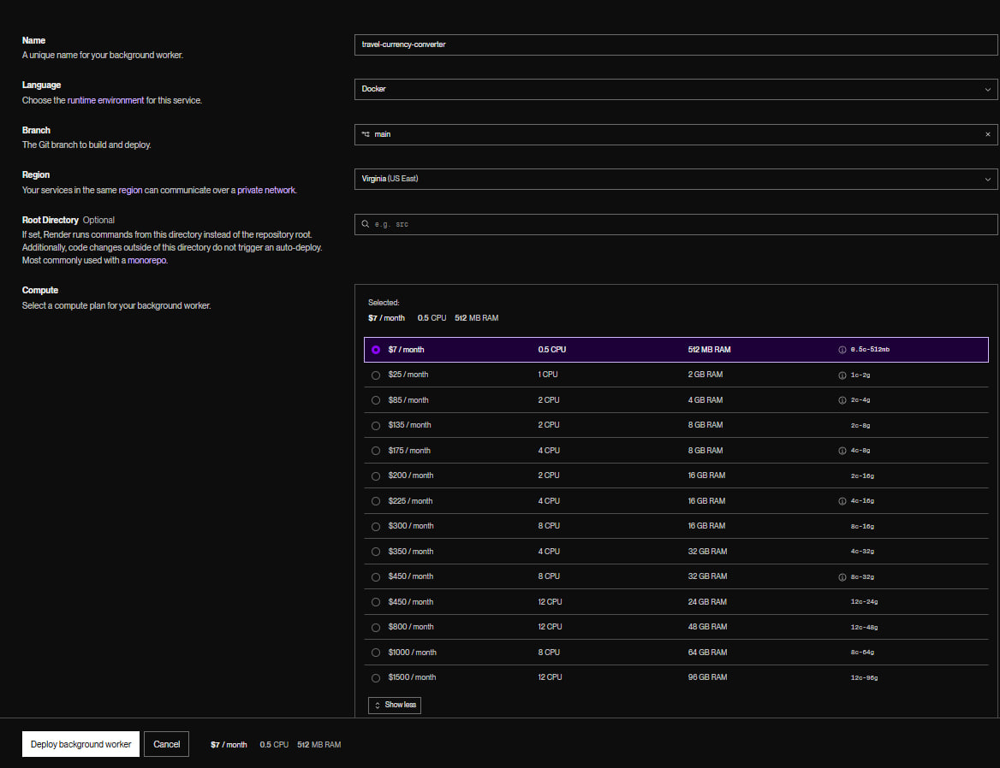

# Travel Currency Converter

## Зміст
1. [Про проєкт](#про-проєкт)
2. [Основні можливості](#основні-можливості)
3. [Технологічний стек](#технологічний-стек)
4. [Архітектура системи](#архітектура-системи)
5. [Команди бота](#команди-бота)
6. [Структура проєкту](#структура-проєкту)
7. [Встановлення](#встановлення)
8. [Налаштування](#налаштування)
9. [Запуск](#запуск)
10. [Обробка помилок](#обробка-помилок)
11. [Безпека](#безпека)
12. [Подальший розвиток](#подальший-розвиток)
13. [Примітка щодо розгортання](#примітка-щодо-розгортання)

## Про проєкт

**Travel Currency Converter** — навчальний Telegram-бот для мандрівників, який надає поточну погоду в обраному місті та допомагає конвертувати суми між валютами. Бот працює через Telegram Bot API та отримує дані від зовнішніх вебсервісів.

Для погоди використовується OpenWeatherMap. Курси валют завантажуються з ExchangeRate-API. Якщо API-ключ ExchangeRate-API не вказано, програма використовує відкритий endpoint `open.er-api.com`.

## Основні можливості

- Отримання поточної погоди для міста, заданого в налаштуваннях, або для міста, зазначеного в команді.
- Виведення опису погоди, температури, відчутної температури, вологості та швидкості вітру.
- Формування короткої рекомендації залежно від погодних умов.
- Конвертація суми між двома валютами за актуальним курсом API.
- Перегляд курсів популярних валют відносно вибраної базової валюти.
- Клавіатурне меню Telegram для швидкого доступу до функцій.
- Перевірка введених даних, журналювання помилок і повторне підключення після тимчасових мережевих збоїв.

## Технологічний стек

| Технологія / сервіс | Призначення |
|---|---|
| Python 3.12 або сумісна версія | Основна мова програмування |
| `requests` | HTTP-запити до Telegram Bot API та зовнішніх API |
| `python-dotenv` | Завантаження параметрів із файлу `.env` |
| Telegram Bot API | Отримання повідомлень і надсилання відповідей користувачам |
| OpenWeatherMap API | Отримання поточної погоди |
| ExchangeRate-API / `open.er-api.com` | Отримання курсів валют |
| `logging` | Запис технічних повідомлень і помилок |
| `decimal.Decimal` | Обчислення сум конвертації з десятковою точністю |

## Архітектура системи

Наведена нижче схема — раніше створена архітектурна ілюстрація проєкту.



**Важливо:** поточна реалізація в `main.py` є Telegram-ботом із циклом опитування Telegram Bot API (`getUpdates`), а не вебзастосунком на Flask. Тому наявна схема, якщо на ній показані Flask, frontend або геолокація через `ipapi.co`, не повністю відповідає реалізованому коду. Для фінального звіту бажано замінити її на схему: **Користувач → Telegram → Telegram Bot API → `main.py` → OpenWeatherMap / ExchangeRate-API → відповідь у Telegram**.

## Команди бота

| Команда | Призначення | Приклад |
|---|---|---|
| `/start` | Привітання та короткий список можливостей | `/start` |
| `/help` | Показує інструкцію з прикладами | `/help` |
| `/weather` | Показує погоду для міста з `WEATHER_CITY` | `/weather` |
| `/weather <місто>` | Показує погоду для вказаного міста | `/weather London` |
| `/convert <сума> <звідки> <куди>` | Конвертує суму між валютами | `/convert 100 EUR UAH` |
| `/rates <валюта>` | Показує курси популярних валют відносно базової | `/rates USD` |

Коди валют потрібно вказувати трьома літерами відповідно до стандартних кодів, наприклад `USD`, `EUR`, `UAH`, `GBP`, `PLN` або `CZK`. Сума має бути більшою за нуль. Для десяткових значень можна використовувати крапку або кому: `/convert 12.50 EUR UAH` або `/convert 12,50 EUR UAH`.

### Приклади роботи

Додайте скриншоти відповідей бота до каталогу `screenshots/` і використайте наведені нижче назви файлів. Якщо ваші скриншоти називаються інакше, змініть шляхи в цьому розділі на фактичні.

**Стартове повідомлення та меню**



**Отримання погоди**





**Конвертація валют**



**Перегляд курсів валют**



**Довідка з командами**



## Структура проєкту

```text
Travel-Currency-Converter/
│
├── main.py              # Основна логіка Telegram-бота
├── requirements.txt     # Залежності Python
├── .env.example         # Приклад змінних середовища
├── .gitignore           # Файли, які не додаються до Git
├── README.md            # Документація проєкту
├── architecture.png     # Архітектурна схема системи
└── screenshots/         # Скриншоти роботи команд бота та хостингу
    ├── start.jpg
    ├── weather.jpg
    ├── convert.jpg
    ├── rates.jpg
    ├── help.jpg
    └── render.jpg
```

## Встановлення

1. Встановіть Python 3.12 або сумісну версію з офіційного сайту: <https://www.python.org/downloads/>.
2. Завантажте або склонуйте репозиторій і перейдіть до каталогу проєкту.
3. Створіть віртуальне середовище:

   **Windows:**
   ```powershell
   python -m venv .venv
   .venv\Scripts\activate
   ```

   **Linux / macOS:**
   ```bash
   python3 -m venv .venv
   source .venv/bin/activate
   ```

4. Встановіть залежності:
   ```bash
   python -m pip install -r requirements.txt
   ```

У файлі `requirements.txt` мають бути щонайменше такі пакети:

```text
requests
python-dotenv
```

## Налаштування

1. Створіть у корені проєкту файл `.env` на основі `.env.example`.
2. Заповніть змінні середовища:

```dotenv
TELEGRAM_BOT_TOKEN=вставте_токен_telegram_бота
WEATHER_API_KEY=вставте_ключ_openweathermap
WEATHER_CITY=Kropyvnytskyi
EXCHANGE_RATE_API_KEY=
```

- `TELEGRAM_BOT_TOKEN` — обов'язковий токен, який можна отримати через офіційного бота `@BotFather` у Telegram.
- `WEATHER_API_KEY` — API-ключ OpenWeatherMap для отримання погоди.
- `WEATHER_CITY` — місто за замовчуванням; якщо змінну не задано, використовується `Kropyvnytskyi`.
- `EXCHANGE_RATE_API_KEY` — необов'язковий ключ ExchangeRate-API. Якщо він порожній, код використовує відкритий endpoint `open.er-api.com`.

Файл `.env` не потрібно додавати до Git. У репозиторій додається лише `.env.example` без справжніх секретів.

## Запуск

Переконайтеся, що віртуальне середовище активовано, залежності встановлено, а файл `.env` заповнено. Запустіть команду з кореневого каталогу проєкту:

```bash
python main.py
```

Якщо запуск пройшов успішно, у консолі з'явиться повідомлення про запуск бота. Відкрийте бота в Telegram і надішліть `/start`.

Поточна реалізація використовує **long polling** через `getUpdates`. Під час роботи процес `main.py` має залишатися запущеним; якщо його зупинити або вимкнути комп'ютер, бот перестане відповідати.

## Обробка помилок

У програмі передбачені такі механізми:

- Перевірка наявності обов'язкового токена Telegram і ключа OpenWeatherMap.
- Перевірка формату коду валюти, суми та кількості аргументів команди конвертації.
- Обробка помилок HTTP-запитів до Telegram та зовнішніх API.
- Повідомлення користувачу, якщо сервіс погоди або курсів валют недоступний чи повернув помилку.
- Запис технічних помилок у журнал за допомогою `logging`.
- Повторна спроба отримання оновлень Telegram після мережевої помилки з паузою п'ять секунд.
- Ігнорування оновлень, які не містять звичайного повідомлення, та повідомлення користувачу про невідому команду.

## Безпека

- Токени й API-ключі зберігаються у `.env`, а не безпосередньо в коді.
- Файл `.env` має бути доданий до `.gitignore`; не публікуйте його в репозиторії та не надсилайте скриншоти з видимими секретами.
- Якщо токен випадково став публічним, відкличте його та створіть новий через `@BotFather`.
- Дані запитів передаються зовнішнім сервісам через HTTPS.
- Отримані курси є довідковими: курс банку або обмінника може відрізнятися.

## Подальший розвиток

У майбутньому проєкт можна вдосконалити такими функціями:

- Додати автоматичне визначення локації користувача за його згодою або за введеним містом.
- Додати вибір базової та цільової валют через кнопки меню.
- Дозволити перегляд прогнозу погоди на кілька днів.
- Додати кешування відповідей API, щоб зменшити кількість запитів.
- Додати автоматизовані тести для перевірки конвертації та обробки помилок.
- Додати обмеження частоти запитів і більш детальне журналювання.
- Розгорнути бота на сервері, який підтримує постійну роботу процесу.

## Примітка щодо розгортання

Під час виконання проєкту було розглянуто безкоштовне розгортання Telegram-бота на хмарному сервісі Render. Однак у процесі налаштування виявилося, що запропонований для цього варіант вимагав переходу на платний тариф. Через це розгорнути бота на Render без оплати не вдалося. Також розглядалися інші варіанти хостингу, але пошуки безкоштовного середовища не дали результатів.

Це не впливає на локальну роботу програми: бот запускається командою `python main.py`, якщо комп'ютер має доступ до інтернету й процес залишається активним.




*Примітка: доступність безкоштовних тарифів хмарних платформ може змінюватися з часом. Перед майбутнім розгортанням слід повторно перевірити актуальні умови сервісів.*
